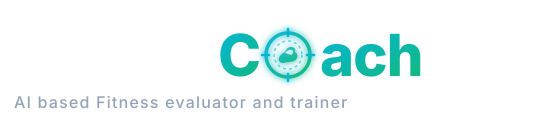

<p align="center">
  
</p>

<p align="center">
  <strong>AI Based Fitness Evaluator & Real-Time Exercise Trainer Engine</strong>
</p>

An AI-powered computer vision application for real-time exercise classification, pose estimation, joint kinematic analysis, and repetition counting across 1,324+ gym exercises. Built with **FastAPI**, **MediaPipe Pose**, a fitted **scikit-learn Decision Tree**, and **OpenCV**, featuring an interactive web dashboard.

---

## ✨ Key Features

- 🏋️ **Real-Time Exercise Recognition**: Detects **Bicep Curls**, **Overhead Press**, and **Squats** using a 30-frame sequence window.
- 🧠 **Fitted Decision-Tree Model**: Interpretable classifier trained on shoulder, elbow, hip, and knee angle features.
- 🔢 **Automated Repetition Counter**: State machine heuristics (`UP` / `DOWN` stages) for accurate rep tracking.
- 📐 **Kinematic Joint Angle & Form Analysis**: Calculates elbow flex, shoulder extension, knee angles, and posture in real time.
- 💻 **Interactive Web Dashboard**: Modern responsive web interface with live webcam feed, video upload, sample video playback, skeletal overlay canvas, and real-time stats.
- ⚙️ **Configurable AI Parameters**: Tune detection confidence, tracking confidence, and classification thresholds on the fly.
- ⚡ **RESTful API**: Standardized FastAPI endpoints for frame processing, stats, counter resets, and system health checks.

---

## 🏗️ Architecture

```
┌─────────────────┐       ┌──────────────────────┐       ┌────────────────────────┐
│  Camera / Video │ ────> │ MediaPipe Pose Task  │ ────> │ 33 3D Pose Keypoints   │
└─────────────────┘       └──────────────────────┘       └───────────┬────────────┘
                                                                      │ (angle features)
                                                                     ▼
┌─────────────────┐       ┌──────────────────────┐       ┌────────────────────────┐
│ Interactive UI  │ <──── │ Rep Counter Engine   │ <──── │ Fitted Decision Tree   │
└─────────────────┘       └──────────────────────┘       └────────────────────────┘
```

---

## 📁 Repository Structure

```
opencv_project/
├── app.py                         # FastAPI server & REST API endpoints
├── exercise_engine.py             # Core AI engine (MediaPipe, Decision Tree, Rep Counter)
├── exercise_classifier.joblib     # Fitted Decision Tree artifact
├── requirements.txt               # Python package dependencies
├── models/
│   ├── pose_landmarker.task       # MediaPipe Pose Landmarker task binary
│   ├── LSTM_Attention.h5          # Legacy weights (not used by the live engine)
│   └── LSTM.h5                    # Legacy weights (not used by the live engine)
├── frontend/                      # Web Application
│   ├── index.html                 # Dashboard layout
│   ├── styles.css                 # Custom CSS styling
│   ├── app.js                     # Frontend video processing, API client & skeletal overlay
│   └── assets/ & samples/         # Static visual assets & sample exercise videos
├── vision.py                      # Computer vision helpers & YOLO fallbacks
├── train_exercise_classifier.py   # Exercise classifier training script
├── train_exercise_yolo.py         # YOLO exercise-pose training script
└── README.md                      # Documentation
```

---

## ⚡ Quick Start

### 1. Prerequisites
- **Python 3.10+**
- Webcam (optional, for live web streaming)

### 2. Installation

Clone or open the project directory and create a virtual environment:

```powershell
# Create virtual environment
python -m venv .venv

# Activate on Windows (PowerShell)
.\.venv\Scripts\Activate.ps1

# Activate on Linux / macOS
source .venv/bin/activate

# Install dependencies
pip install -r requirements.txt
```

### 3. Running the Application

Launch the server using Python:

```powershell
python app.py
```

Or run directly with Uvicorn:

```powershell
uvicorn app:app --host 0.0.0.0 --port 8001 --reload
```

Navigate to:
- 🌐 **Web Dashboard**: [http://localhost:8001/](http://localhost:8001/)
- 📖 **Interactive Swagger API Docs**: [http://localhost:8001/docs](http://localhost:8001/docs)

---

## 📡 API Endpoints Summary

| Method | Endpoint | Description |
| :--- | :--- | :--- |
| `GET` | `/api/v1/health` | Returns server health status, active model info, and supported actions |
| `POST` | `/api/v1/process_frame` | Processes an uploaded video/image frame, extracts pose keypoints, performs inference, and updates rep state |
| `GET` | `/api/v1/stats` | Retrieves current exercise state, confidence scores, rep counts, and stages |
| `POST` | `/api/v1/reset_counters` | Resets rep counters for all exercises back to `0` |
| `POST` | `/api/v1/settings` | Updates detection confidence, tracking confidence, and classification thresholds |

---

## 🧠 Decision-Tree Model Details

- **Input Features**: Average left/right shoulder, elbow, hip, and knee angles.
- **Estimator**: Fitted `DecisionTreeClassifier(max_depth=6, min_samples_leaf=8)`.
- **Output Classes**: `curl`, `press`, `squat`.
- **Stability**: A prediction must remain stable for three frames before it can drive the rep state machine.

---

## 📄 License

This project is licensed under the [MIT License](LICENSE) — see the [LICENSE](LICENSE) file for details.

Copyright (c) 2026 Vipul Pal.

